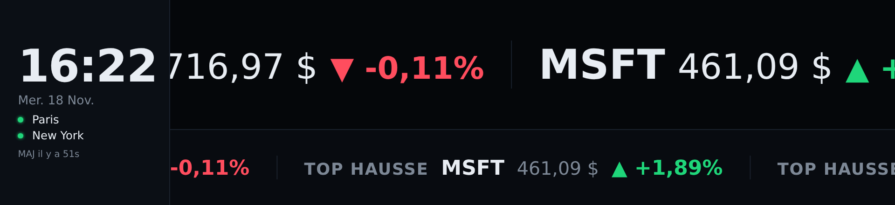
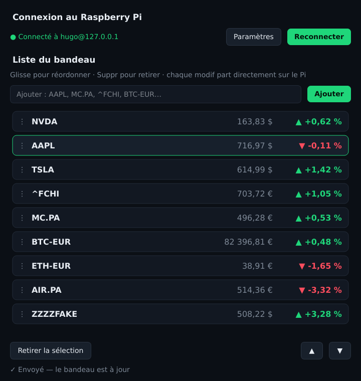
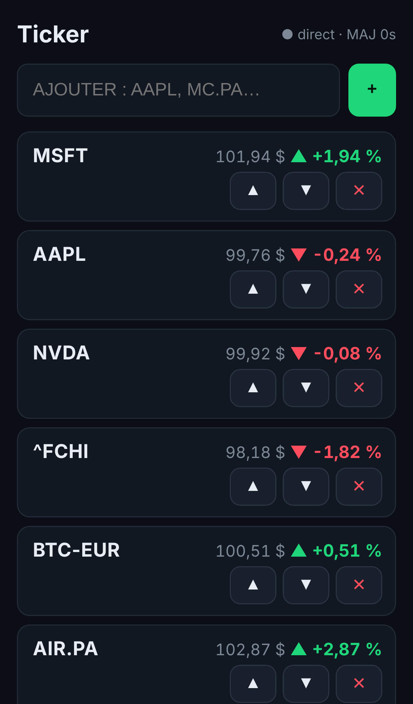

# 📈 Ticker Bandeau

Bandeau boursier défilant façon Wall Street, sur un **Raspberry Pi 5** branché à un écran barre
**Wisecoco 11,3" 1920×440**. Les cours arrivent **en direct** (flux temps réel Yahoo Finance) et la liste
des actions se pilote depuis **trois endroits** : une appli Windows (SSH), une page web pour téléphone,
utilisable partout grâce à **Tailscale**, et n'importe quel navigateur.



---

## Sommaire

1. [Vue d'ensemble](#1-vue-densemble)
2. [Matériel et logiciels](#2-matériel-et-logiciels)
3. [Installation sur le Raspberry Pi](#3-installation-sur-le-raspberry-pi)
4. [Comment marche le serveur (le direct)](#4-comment-marche-le-serveur-le-direct)
5. [Le bandeau (index.html)](#5-le-bandeau-indexhtml)
6. [L'appli PC Windows (TickerBandeau.exe)](#6-lappli-pc-windows-tickerbandeauexe)
7. [Accès depuis le téléphone, partout (Tailscale + page mobile)](#7-accès-depuis-le-téléphone-partout-tailscale--page-mobile)
8. [Symboles acceptés](#8-symboles-acceptés)
9. [Commandes utiles](#9-commandes-utiles)
10. [Problèmes rencontrés et solutions](#10-problèmes-rencontrés-et-solutions)
11. [Arrivée de l'écran Wisecoco](#11-arrivée-de-lécran-wisecoco)
12. [Arborescence du dépôt](#12-arborescence-du-dépôt)

---

## 1. Vue d'ensemble

```
                         ┌────────────────────── Raspberry Pi 5 (Debian 13 Trixie) ──────────────────────┐
                         │                                                                               │
 Yahoo Finance ══ flux ══╪══► server.py  (Flask, port 8050, service systemd « ticker »)                  │
 (WebSocket temps réel)  │      ├─ flux en direct : chaque transaction ≈ 1 s                            │
 + fast_info / 60 s ─────╪──►   ├─ base toutes les 60 s : clôture de la veille, devise                  │
                         │      ├─ /api/quotes   → prix + variation de chaque symbole                   │
                         │      ├─ /api/tickers  → lire / modifier la liste (tickers.json)              │
                         │      ├─ /             → le bandeau (index.html)                              │
                         │      └─ /edit         → la page de contrôle mobile (edit.html)               │
                         │                │                                                              │
                         │                ▼                                                              │
                         │      Chromium --kiosk  ──►  écran HDMI 1920×440                              │
                         └───────────────▲───────────────────────▲───────────────────────────────────────┘
                                         │ SSH (SFTP)            │ HTTP via Tailscale (réseau privé chiffré)
                         ┌───────────────┴─────────┐   ┌─────────┴─────────────────┐
                         │ 💻 TickerBandeau.exe    │   │ 📱 Téléphone (wifi ou 4G) │
                         │    appli PC Windows     │   │    http://<IP-Tailscale>  │
                         └─────────────────────────┘   │           :8050/edit      │
                                                       └───────────────────────────┘
```

**Ce qui se passe quand tu ajoutes une action**, depuis l'appli PC ou le téléphone :

```
tu ajoutes AIR.PA ──► tickers.json mis à jour sur le Pi ──► le serveur se réabonne au flux Yahoo
                  ──► le bandeau l'affiche en moins de 2 s
```

---

## 2. Matériel et logiciels

| Élément | Détail |
|---|---|
| Ordinateur | Raspberry Pi 5, 8 Go (4 Go suffisent) |
| Système | Raspberry Pi OS / Debian 13 *Trixie*, **avec bureau** (labwc) |
| Écran | Wisecoco 11,3" IPS **1920×440** (n'importe quel écran HDMI marche pour tester) |
| Serveur | Python 3.13 · Flask · yfinance (dans un venv `~/ticker/venv`) |
| Affichage | Chromium en mode kiosque |
| Appli PC | Python 3.13 · PySide6 (interface) · paramiko (SSH) · PyInstaller (→ .exe) |
| Accès distant | Tailscale (gratuit, aucun port ouvert sur la box) |

---

## 3. Installation sur le Raspberry Pi

### Méthode rapide (script)

Connecté en SSH **avec ton utilisateur normal** (invite `hugo@…:~ $`, **pas** `root@… #`) :

```bash
git clone https://github.com/GhostRII/<ce-depot>.git ticker-bandeau
cd ticker-bandeau/pi
chmod +x install.sh && ./install.sh
sudo reboot
```

Le script fait les 5 étapes décrites ci-dessous et affiche à la fin les vrais cours et les adresses utiles.

### Méthode détaillée (ce que fait le script, étape par étape)

| # | Étape | Commande clé |
|---|---|---|
| 0 | Être sur le bon utilisateur (pas root) | `exit` si l'invite finit par `#` |
| 1 | Paquets système | `sudo apt install -y python3-venv curl chromium` |
| 2 | Dossier + venv + modules | `mkdir -p ~/ticker && cd ~/ticker && python3 -m venv venv && LC_ALL=C.UTF-8 ./venv/bin/pip install --timeout 60 flask yfinance` |
| 3 | Fichiers | `server.py`, `index.html`, `edit.html` dans `~/ticker/` + `tickers.json` (liste de départ) |
| 4 | Service systemd | `/etc/systemd/system/ticker.service` → `sudo systemctl enable --now ticker` |
| 5 | Plein écran au démarrage | `~/.config/autostart/ticker-kiosk.desktop` → lance `chromium --kiosk http://localhost:8050` |

Vérification :

```bash
systemctl is-active ticker                 # → active
curl -s localhost:8050/api/quotes          # → {"data":[{"s":"AAPL","p":...,"c":...}...],"ts":...}
```

---

## 4. Comment marche le serveur (le direct)

Interroger Yahoo **chaque seconde** pour chaque symbole ferait environ 30 000 requêtes par heure, et Yahoo bloquerait le Pi.
Le serveur utilise donc **deux sources complémentaires** :

```
 ┌─ stream_loop() ─────────────────────────────────────────────┐
 │  yf.WebSocket → abonné à tous les symboles de tickers.json  │   chaque transaction (~1 s)
 │  on_tick() met à jour le prix + la variation                │ ─────────────────────────► quotes{}
 │  connexion coupée ? → reconnexion auto au bout de 2 s       │
 └─────────────────────────────────────────────────────────────┘
 ┌─ baseline_loop() ───────────────────────────────────────────┐
 │  toutes les 60 s : yf.Ticker(s).fast_info                   │   clôture veille, devise,
 │  → clôture de la veille (pour calculer la variation)        │ ─────────────────────────► quotes{}
 │  → prix seulement si le direct est muet depuis 2 min        │   prix si marché fermé
 └─────────────────────────────────────────────────────────────┘
```

- La **variation %** est calculée à partir de la clôture de la veille : `(prix − clôture) / clôture × 100`.
- Quand la liste change (POST `/api/tickers`), le serveur **ferme le flux**, puis se reconnecte et s'abonne aussitôt à la nouvelle liste.
- **Fraîcheur selon le marché :** crypto en temps réel 24h/24, actions US en quasi temps réel pendant les heures d'ouverture,
  **Euronext Paris (CAC 40, `.PA`) avec environ 15 min de retard chez Yahoo** (licence de la bourse). Marché fermé : le prix ne bouge plus.

### API

| Route | Méthode | Rôle |
|---|---|---|
| `/` | GET | le bandeau |
| `/edit` | GET | la page de contrôle mobile |
| `/api/quotes` | GET | `{"data":[{"s","p","c","cur"}...], "ts": dernière MAJ}` |
| `/api/tickers` | GET | la liste actuelle |
| `/api/tickers` | POST | remplace la liste (JSON `["AAPL","MC.PA",…]`), met les symboles en majuscules et retire les doublons |

---

## 5. Le bandeau (index.html)

```
┌────────────┬──────────────────────────────────────────────────────────────┐
│  18:06     │  AAPL 352,67 $ ▼ −0,55 %   MSFT 503,39 $ ▼ −1,25 %   ◄── défile │  63 % : toute la liste
│  Mer. 18   │                                                              │
│  ● Paris   ├──────────────────────────────────────────────────────────────┤
│  ● New York│  ──► TOP BAISSE NVDA ▼ −5,62 %   TOP HAUSSE …                │  37 % : top 3 hausses/baisses
│  MAJ 1s    │                                                              │
└────────────┴──────────────────────────────────────────────────────────────┘
```

- Conçu pour **1920×440** : tailles en `vh`/`vw`, donc **déformé dans une fenêtre 16:9**, c'est normal.
  Pour voir le vrai rendu sur PC : Edge/Chrome → **F12** → **Ctrl+Maj+M** → dimensions **1920 × 440**.
- Rafraîchissement **toutes les 1 s** (`setInterval(poll, 1000)`). Les valeurs sont mises à jour **sur place**, sans relancer le défilement.
- Voyants **vert** quand la bourse est ouverte : Paris 9h00–17h30, New York 9h30–16h00 (heure de New York), du lundi au vendredi.
- Hausses en **vert ▲**, baisses en **rouge ▼**. Vitesse réglable en haut du script (`SPEED1`, `SPEED2` en pixels par seconde).

---

## 6. L'appli PC Windows (TickerBandeau.exe)



Elle se connecte au Pi **en SSH, comme PuTTY**, lit et écrit `~/ticker/tickers.json` par SFTP, puis prévient le serveur.

```
TickerBandeau.exe ──SSH──► Pi : écrit tickers.json (atomique : .tmp puis renommage)
                          └─► curl POST localhost:8050/api/tickers  →  le bandeau se met à jour
                  ◄──SSH── curl localhost:8050/api/quotes  →  prix affichés à côté de chaque ligne (toutes les 20 s)
```

**Fonctions :** glisser-déposer pour réordonner, ▲ ▼, touche **Suppr** pour retirer, ajout de plusieurs symboles d'un coup (`AAPL, MC.PA`),
couleur selon la variation, « introuvable » si le symbole n'existe pas. Chaque modification est **envoyée immédiatement**.

**Sécurité :** le mot de passe n'est **jamais enregistré**. À la première connexion, l'empreinte de la clé du Pi est affichée puis mémorisée
dans `~/.ticker_gui_known_hosts`, ce qui protège contre une usurpation du Pi.
Connexion par mot de passe ou par clé SSH.

### Fabriquer le .exe

```bat
:: 1. Installer Python (une seule fois)
winget install -e --id Python.Python.3.13
:: 2. FERMER et ROUVRIR cmd, puis vérifier
py --version
:: 3. Double-clic sur desktop\build_exe.bat  →  desktop\dist\TickerBandeau.exe
```

`build_exe.bat` installe PySide6, paramiko et PyInstaller, puis assemble **un seul .exe autonome** (plus besoin de Python pour le lancer).
Il utilise `python` ou, à défaut, `py`, ce qui contourne le faux raccourci « python » du Microsoft Store.

Lancer sans compiler : `cd desktop && py -m pip install -r requirements.txt && py ticker_gui.py`

---

## 7. Accès depuis le téléphone, partout (Tailscale + page mobile)



**Tailscale** crée un réseau privé chiffré entre tes appareils. Ton téléphone joint le Pi **comme s'il était chez toi**, en 4G ou depuis
le wifi d'un ami, **sans ouvrir aucun port sur la box**. C'est important, parce que l'API n'a pas de mot de passe et ne doit pas être exposée sur Internet.

```
📱 téléphone (4G) ══ tunnel Tailscale chiffré ══► 🍓 Pi (adresse 100.x.y.z) ──► :8050/edit
```

### Mise en place

| # | Où | Quoi |
|---|---|---|
| 1 | Pi | `curl -fsSL https://tailscale.com/install.sh \| sh` (script officiel) |
| 2 | Pi | `sudo tailscale up --ssh` → ouvrir le lien affiché → se connecter (Google/GitHub/Microsoft) → **Connect** |
| 3 | Pi | `tailscale ip -4` → note l'adresse **100.x.y.z** |
| 4 | Téléphone | appli **Tailscale** → se connecter avec **le même compte** → accepter le VPN → **Connected** |
| 5 | Pi | `tailscale status` → doit lister **2 appareils** (le Pi + le téléphone) |
| 6 | Téléphone | ouvrir `http://100.x.y.z:8050/edit` → menu ⋮ → **Ajouter à l'écran d'accueil** |

`--ssh` permet en plus de se connecter en SSH au Pi via Tailscale, depuis n'importe où.

### La page de contrôle (`/edit`)

Liste avec **prix et variation en direct** (rafraîchis toutes les 2 s), champ d'ajout, boutons **▲ ▼ ✕** assez gros pour le doigt
(le glisser-déposer marche mal sur mobile, d'où les boutons). En haut à droite : `● direct · MAJ Xs`, ou `✗ Pi injoignable`.

---

## 8. Symboles acceptés

Format **Yahoo Finance** :

| Type | Exemples |
|---|---|
| Actions US | `AAPL` Apple · `MSFT` Microsoft · `NVDA` Nvidia · `TSLA` Tesla |
| Actions Paris | `MC.PA` LVMH · `AIR.PA` Airbus · `OR.PA` L'Oréal · `TTE.PA` TotalEnergies |
| Indices | `^FCHI` CAC 40 · `^GSPC` S&P 500 · `^IXIC` Nasdaq |
| Crypto | `BTC-EUR` · `ETH-EUR` · `SOL-USD` |
| Devises | `EURUSD=X` |

Un symbole inconnu s'affiche « — » sur le bandeau et « introuvable » dans l'appli PC.

---

## 9. Commandes utiles

| Action | Commande (sur le Pi) |
|---|---|
| État du serveur | `systemctl status ticker --no-pager` |
| Journal en direct | `journalctl -u ticker -f` |
| Redémarrer le serveur | `sudo systemctl restart ticker` |
| Voir les cours | `curl -s localhost:8050/api/quotes` |
| Voir / changer la liste à la main | `cat ~/ticker/tickers.json` · `nano ~/ticker/tickers.json` |
| Fermer le plein écran | **Alt + F4** sur le Pi |
| Désactiver le plein écran auto | `rm ~/.config/autostart/ticker-kiosk.desktop` |
| Réseau Tailscale | `tailscale status` · `tailscale ip -4` |
| Adresse locale du Pi | `hostname -I` |

---

## 10. Problèmes rencontrés et solutions

Problèmes réellement rencontrés pendant la mise en place :

| Symptôme | Cause | Solution |
|---|---|---|
| Collage PuTTY mélangé, `$'\E[200~cat'` : commande introuvable | Bloc trop long (≈ 300 lignes) collé d'un coup | Coller des **petits blocs** (moins de 100 lignes), ou utiliser `nano` |
| Fichier collé dans nano coupé au milieu (103 lignes au lieu de 125) | Limite de collage de PuTTY | Compléter avec `cat >> fichier <<'EOF' … EOF`, toujours vérifier avec `wc -l` et `tail -1` |
| Installé en root par erreur | Session ouverte en root | `exit` avant tout, l'invite doit finir par `$`. Ménage : `sudo rm -rf /root/ticker` |
| `pip` : `UnicodeDecodeError: 'utf-8' codec can't decode byte 0xe9` | Échec réseau passager **et** message système en français (« é ») mal décodé | Relancer avec `LC_ALL=C.UTF-8 … pip install --timeout 60 …` |
| Service `activating (auto-restart)`, journal : `Port 8050 is in use` | Un serveur de test lancé à la main tournait encore | `pkill -f "python server.py"` puis `sudo systemctl restart ticker` |
| Plein écran ne se lance pas, `exec  --kiosk` (vide) | Chromium pas installé | `sudo apt install -y chromium` puis refaire le `.desktop` avec `/usr/bin/chromium` |
| Bandeau énorme / déformé sur le PC | Page calculée pour 440 px de haut | Normal. Tester en 1920×440 avec F12 → Ctrl+Maj+M |
| Windows : `Python was not found` juste après l'installation | Fenêtre cmd ouverte avant, plus le faux raccourci du Store | Fermer et rouvrir cmd, utiliser `py` |
| Téléphone n'atteint pas `100.x.y.z` | Téléphone absent du réseau Tailscale (`tailscale status` = 1 ligne) | Même compte que le Pi, VPN autorisé, couper les autres VPN (« Wi-Fi sécurisé » Samsung) |

---

## 11. Arrivée de l'écran Wisecoco

1. Brancher le Wisecoco en **HDMI** à la place de l'écran actuel, puis redémarrer.
2. Beaucoup d'écrans barre sont des **dalles verticales**. Si l'image est couchée :
   *Menu → Préférences → Screen Configuration → clic droit sur l'écran → Orientation*,
   ou `wlr-randr` (puis `wlr-randr --output HDMI-A-1 --transform 90`).
3. Le curseur de la souris est masqué sur le bandeau (`cursor:none`).

---

## 12. Arborescence du dépôt

```
.
├── README.md               ← ce fichier
├── pi/                     ← tout ce qui tourne sur le Raspberry Pi
│   ├── server.py           ← serveur Flask : flux direct Yahoo + API
│   ├── index.html          ← le bandeau 1920×440
│   ├── edit.html           ← la page de contrôle mobile (/edit)
│   └── install.sh          ← installation complète en une commande
├── desktop/                ← l'appli Windows
│   ├── ticker_gui.py       ← interface PySide6 + SSH paramiko
│   ├── requirements.txt
│   └── build_exe.bat       ← fabrique TickerBandeau.exe
└── docs/                   ← captures d'écran
```

> ⚠️ Les captures d'écran de ce dépôt ont été faites avec des **prix fictifs** pendant le développement.
